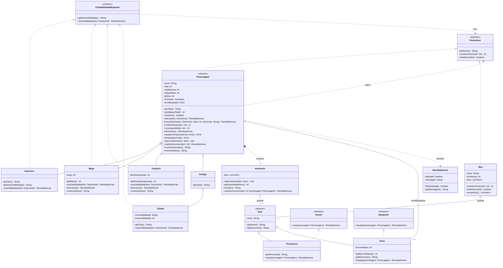
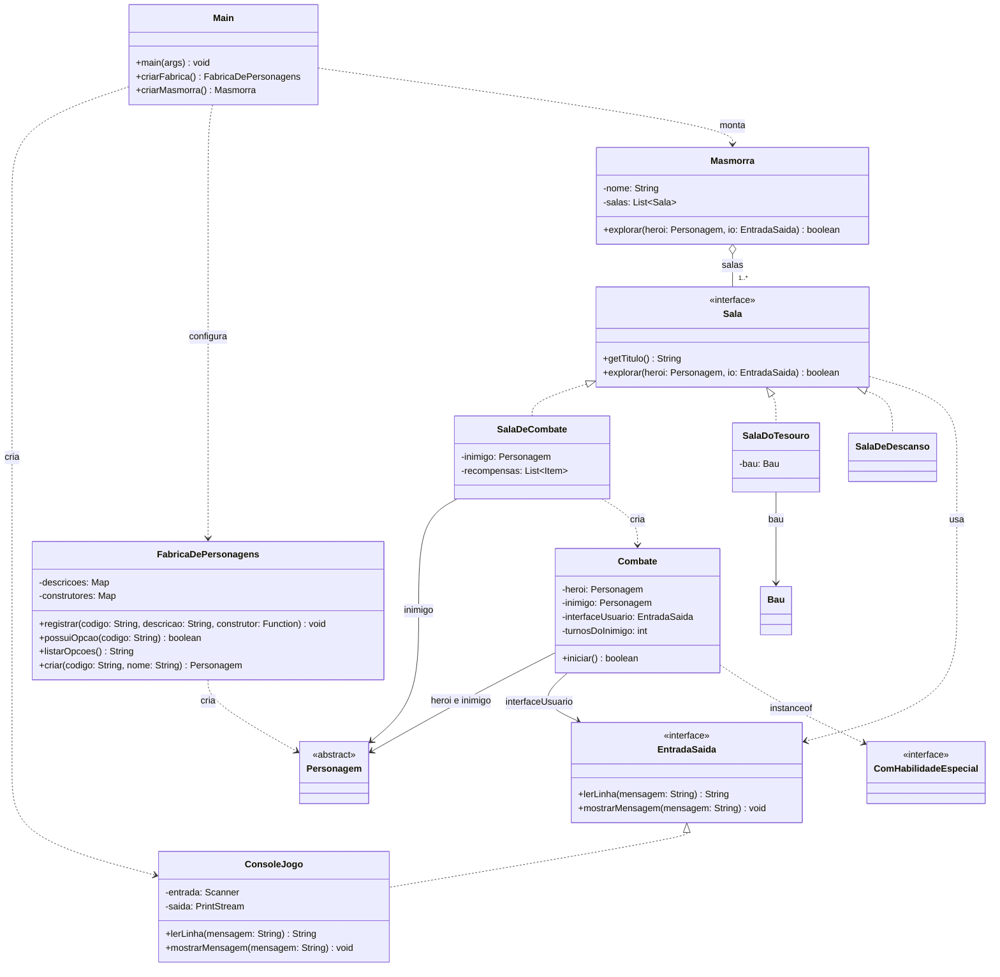
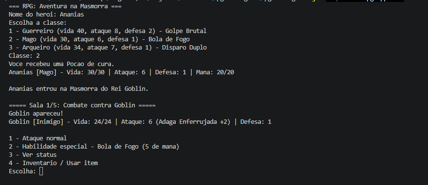
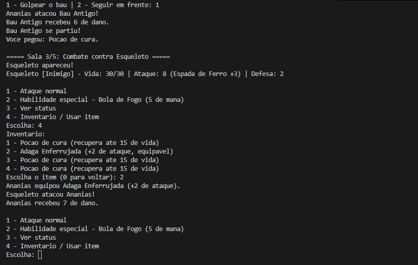
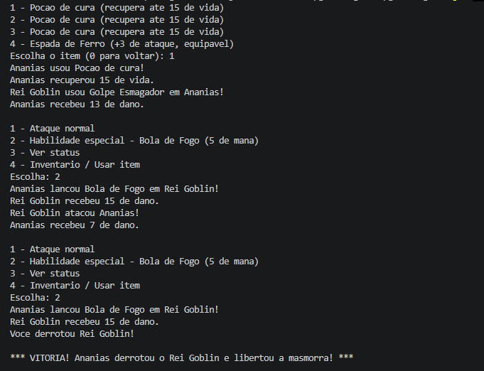

# RPG: Aventura na Masmorra

Trabalho prático da disciplina **Paradigmas de Programação**: um RPG de console em Java que aplica os conceitos de **Programação Orientada a Objetos** e os cinco princípios **SOLID**.

O jogador escolhe um herói (Guerreiro, Mago ou Arqueiro) e atravessa as cinco salas da **Masmorra do Rei Goblin**: combates em turnos contra inimigos comuns, um baú para quebrar, uma fogueira para descansar e, no fim, a luta contra o chefão.

---

## Sumário

1. [Funcionalidades](#funcionalidades)
2. [Como compilar e executar](#como-compilar-e-executar)
3. [Como jogar](#como-jogar)
4. [Estrutura do projeto](#estrutura-do-projeto)
5. [Diagrama de classes (UML)](#diagrama-de-classes-uml)
6. [Orientação a Objetos no projeto](#orientação-a-objetos-no-projeto)
7. [Princípios SOLID](#princípios-solid)
8. [Capturas de tela](#capturas-de-tela)
9. [Testes automáticos](#testes-automáticos)

---

## Funcionalidades

**Personagens jogáveis**, todos com Vida, Ataque e Defesa e uma habilidade especial:

| Classe | Vida | Ataque | Defesa | Habilidade especial |
| --- | ---: | ---: | ---: | --- |
| Guerreiro | 40 | 8 | 2 | **Golpe Brutal**: ataque + 5 |
| Mago | 30 | 6 | 1 | **Bola de Fogo**: ataque + 10, custa 5 de mana (mana máxima 20) |
| Arqueiro | 34 | 7 | 1 | **Disparo Duplo**: duas flechas, cada uma com ataque + 2; gasta 1 de 3 flechas especiais |

**Inimigos e chefão**:

| Inimigo | Vida | Ataque | Defesa | Observação |
| --- | ---: | ---: | ---: | --- |
| Goblin | 24 | 4 (+2 da Adaga Enferrujada) | 1 | Deixa cair a adaga ao ser derrotado |
| Esqueleto | 30 | 5 (+3 da Espada de Ferro) | 2 | Deixa cair a espada ao ser derrotado |
| Rei Goblin (chefão) | 55 | 8 | 3 | A cada 3 turnos usa o **Golpe Esmagador** (ataque + 6) |

**Combate em turnos**: atacar, usar a habilidade especial, ver o status ou abrir o inventário. Ver o status, cancelar e escolher uma opção inválida não gastam o turno. O dano sofrido é `ataque - defesa`, nunca negativo.

**Itens e inventário**:
- **Poção de cura**: recupera até 15 de vida e é consumida. Com a vida cheia, ela é recusada e continua no inventário.
- **Armas** (Adaga Enferrujada +2, Espada de Ferro +3): podem ser equipadas e aumentam o ataque. Ao trocar de arma, a antiga volta para o inventário.

**Masmorra com cinco salas**: Goblin → Baú Antigo → Esqueleto → Fogueira → Rei Goblin.

---

## Como compilar e executar

**Requisito:** JDK 17 ou superior (testado com OpenJDK 25). Não há bibliotecas externas.

Na pasta raiz do projeto, os mesmos comandos funcionam no PowerShell, no Prompt de Comando e no Bash:

```bash
# Compilar (o -sourcepath faz o javac encontrar todas as classes a partir do Main)
javac -encoding UTF-8 -d build -sourcepath src src/rpg/app/Main.java

# Executar
java -cp build rpg.app.Main
```

Para compilar e rodar os testes automáticos:

```bash
javac -encoding UTF-8 -d build -sourcepath src testes/TestesRpg.java
java -cp build TestesRpg
```

> No VS Code, com a extensão *Extension Pack for Java*, também dá para abrir `src/rpg/app/Main.java` e clicar em **Run**.

---

## Como jogar

1. Digite o nome do herói (se ficar em branco, ele se chama "Heroi").
2. Escolha a classe: `1` Guerreiro, `2` Mago ou `3` Arqueiro.
3. Em cada turno de combate, escolha:
   - `1` Ataque normal
   - `2` Habilidade especial
   - `3` Ver status (não gasta o turno)
   - `4` Inventário: digite o número do item para usar uma poção ou equipar uma arma (`0` volta)
4. No baú, digite `1` para golpeá-lo ou `2` para seguir em frente.
5. Vença o Rei Goblin para libertar a masmorra.

**Dica:** equipe as armas que os inimigos deixam cair e guarde as poções para o chefão.

---

## Estrutura do projeto

A organização em pacotes segue a sugestão do material da disciplina: o domínio fica separado da apresentação, e a montagem do jogo fica no `app`.

```
src/rpg/
├── app/                      # Ponto de entrada e montagem dos objetos
│   └── Main.java
├── apresentacao/             # Entrada e saída (terminal)
│   ├── EntradaSaida.java     # interface
│   └── ConsoleJogo.java
├── jogo/                     # Fluxo do jogo
│   ├── Combate.java
│   ├── Masmorra.java
│   ├── Sala.java             # interface
│   ├── SalaDeCombate.java
│   ├── SalaDoTesouro.java
│   ├── SalaDeDescanso.java
│   └── FabricaDePersonagens.java
└── dominio/                  # Regras do jogo, sem nenhuma impressão no console
    ├── Destrutivel.java              # interface
    ├── ComHabilidadeEspecial.java    # interface
    ├── ResultadoAcao.java
    ├── personagens/
    │   ├── Personagem.java   # classe abstrata
    │   ├── Guerreiro.java
    │   ├── Mago.java
    │   ├── Arqueiro.java
    │   ├── Inimigo.java
    │   └── Chefao.java
    ├── itens/
    │   ├── Item.java         # classe abstrata
    │   ├── Usavel.java       # interface
    │   ├── Equipavel.java    # interface
    │   ├── PocaoCura.java
    │   ├── Arma.java
    │   └── Inventario.java
    └── cenario/
        └── Bau.java
testes/
└── TestesRpg.java            # testes automáticos sem bibliotecas externas
```

---

## Diagrama de classes (UML)

O diagrama foi dividido em duas partes para ficar legível. Legenda (notação UML):

| Seta | Significado |
| --- | --- |
| `<\|--` linha cheia, triângulo vazado | Herança (`extends`) |
| `<\|..` linha tracejada, triângulo vazado | Realização de interface (`implements`) |
| `*--` losango cheio | Composição: a parte só existe dentro do todo |
| `o--` losango vazio | Agregação: a parte existe independentemente do todo |
| `-->` | Associação: atributo que referencia outra classe |
| `..>` | Dependência: uso temporário, por parâmetro ou criação |

Em cada classe, `+` significa público, `-` privado e `#` protegido. Métodos marcados com `*` são abstratos.

### Parte 1: domínio (personagens, itens e contratos)



### Parte 2: fluxo do jogo e apresentação



---

## Orientação a Objetos no projeto

| Pilar | Onde aparece |
| --- | --- |
| **Abstração** | [`Personagem`](src/rpg/dominio/personagens/Personagem.java) e [`Item`](src/rpg/dominio/itens/Item.java) são classes **abstratas** e não podem ser instanciadas, porque "personagem" e "item" sozinhos são conceitos incompletos. Os contratos ficam em interfaces: `Destrutivel`, `ComHabilidadeEspecial`, `Usavel`, `Equipavel`, `Sala` e `EntradaSaida`. |
| **Encapsulamento** | Todos os atributos são `private`. A vida só muda por `receberDano()` e `curar()`, que garantem que ela fique entre 0 e o máximo. A mana do Mago e as flechas do Arqueiro só mudam pela habilidade e pelo descanso. O método auxiliar `causarDano()` é `protected`, visível apenas para as subclasses. |
| **Herança** | `Guerreiro`, `Mago`, `Arqueiro` e `Inimigo` herdam de `Personagem`; `Chefao` herda de `Inimigo`. `PocaoCura` e `Arma` herdam de `Item`. |
| **Polimorfismo dinâmico** | `usarHabilidade()` tem uma implementação diferente em cada classe. `descansar()` é **sobrescrito** pelo Mago (restaura a mana) e pelo Arqueiro (recupera as flechas), ambos chamando `super.descansar()`. `mostrarStatus()` é sobrescrito para mostrar mana e flechas. `Masmorra` chama `sala.explorar()` sem saber o tipo da sala. |
| **Composição** (`*--`) | `Personagem` **contém** um `Inventario`, criado dentro dele, que só existe junto com o personagem. |
| **Agregação** (`o--`) | `Personagem` **possui** uma `Arma`: quando o Goblin é derrotado, `desequiparArma()` solta a Adaga, que continua existindo e é equipada pelo herói. O `Bau` agrega itens: quando quebra, os itens sobrevivem. |

---

## Princípios SOLID

### S: Single Responsibility (Responsabilidade Única)

> *Uma classe deve ter um, e apenas um, motivo para mudar.*

Cada classe cuida de uma parte do sistema:

| Classe | Única responsabilidade |
| --- | --- |
| [`Personagem`](src/rpg/dominio/personagens/Personagem.java) | Regras de vida, ataque, defesa, cura e arma equipada |
| [`Inventario`](src/rpg/dominio/itens/Inventario.java) | Guardar, listar e utilizar itens (`Personagem` apenas delega para ele) |
| [`Combate`](src/rpg/jogo/Combate.java) | Controlar a ordem dos turnos de uma luta |
| [`Masmorra`](src/rpg/jogo/Masmorra.java) | Percorrer a sequência de salas |
| [`ConsoleJogo`](src/rpg/apresentacao/ConsoleJogo.java) | Ler do teclado e escrever no terminal |
| [`FabricaDePersonagens`](src/rpg/jogo/FabricaDePersonagens.java) | Criar o herói a partir da opção do menu |
| [`Main`](src/rpg/app/Main.java) | Montar os objetos e iniciar o jogo |

Um ponto importante: **nenhuma classe do domínio usa `System.out` ou `Scanner`**. Em vez de imprimir, as regras devolvem um [`ResultadoAcao`](src/rpg/dominio/ResultadoAcao.java), que informa se a ação gastou o turno e qual mensagem mostrar. Quem decide como exibir é a camada de apresentação. É a correção apontada no material da disciplina para o `receberDano()` original, que acumulava cálculo, formatação, impressão e decisão de derrota.

### O: Open/Closed (Aberto/Fechado)

> *Aberto para extensão, fechado para modificação.*

| Para adicionar... | Basta... | Sem alterar... |
| --- | --- | --- |
| Uma nova classe de herói (ex.: Paladino) | criar `Paladino extends Personagem implements ComHabilidadeEspecial` e registrá-lo com uma linha em `Main.criarFabrica()` | `Combate`, `FabricaDePersonagens`, `Masmorra` |
| Um novo tipo de sala (ex.: armadilha) | criar uma classe que `implements Sala` | `Masmorra` |
| Uma nova poção ou arma | criar uma classe que estenda `Item` e implemente `Usavel` ou `Equipavel` | `Inventario`, `Combate` |
| Um novo alvo de ataque (ex.: portão) | criar uma classe que `implements Destrutivel` | `Personagem.atacar()` |
| Um novo chefão | instanciar `Chefao` com outros valores, ou criar uma subclasse | `Combate` |

O `Arqueiro` e o `Chefao` foram adicionados exatamente assim: nenhuma linha de `Combate` precisou mudar para que eles funcionassem.

### L: Liskov Substitution (Substituição de Liskov)

> *Objetos de uma subclasse devem poder substituir objetos da classe base sem quebrar o programa.*

- `Combate` recebe herói e inimigo como `Personagem`. Qualquer subclasse (Guerreiro, Mago, Arqueiro, Inimigo ou Chefao) funciona no lugar sem conversões.
- `Personagem` **não declara** `usarHabilidade()`. No material da disciplina, colocar esse método na classe base obrigava o `Inimigo` a ter um método que ele não sabe executar, e um laço `p.usarHabilidade(...)` sobre uma lista de personagens quebrava. Aqui, todo `Personagem` cumpre 100% do contrato de `Personagem`.
- As sobrescritas **ampliam** o comportamento sem contrariar a classe mãe: `Mago.descansar()` e `Arqueiro.descansar()` chamam `super.descansar()` (curam a vida normalmente) e depois recuperam o próprio recurso.
- O contrato de `ComHabilidadeEspecial.usarHabilidade()` documenta que a ação pode não ser realizada (sem mana ou sem flechas). Nesse caso, nada no jogo muda e o turno não é gasto. Todas as implementações respeitam isso, e o `Combate` trata o resultado de forma uniforme.

O teste *"LSP: qualquer Personagem funciona no lugar do tipo base"* percorre uma `List<Personagem>` com todas as subclasses chamando os mesmos métodos.

### I: Interface Segregation (Segregação de Interfaces)

> *Nenhuma classe deve ser forçada a implementar métodos que não vai usar.*

Em vez de uma interface grande, o projeto tem contratos pequenos e específicos:

| Interface | Métodos | Quem implementa | Quem **não** é obrigado |
| --- | --- | --- | --- |
| `Destrutivel` | `getNome`, `receberDano`, `estaDestruido` | `Personagem`, `Bau` | - |
| `ComHabilidadeEspecial` | `getNomeHabilidade`, `usarHabilidade` | `Guerreiro`, `Mago`, `Arqueiro`, `Chefao` | `Inimigo` comum |
| `Usavel` | `usar` | `PocaoCura` | `Arma` |
| `Equipavel` | `equipar` | `Arma` | `PocaoCura` |
| `Sala` | `getTitulo`, `explorar` | as três salas | - |
| `EntradaSaida` | `lerLinha`, `mostrarMensagem` | `ConsoleJogo` | - |

A separação `Usavel` / `Equipavel` resolve exatamente o problema da lista de revisão (Questão 2): uma `PocaoCura` não precisa de um `equipar()` que lance `UnsupportedOperationException`. O `Inventario` e o `Combate` usam `instanceof` para descobrir qual contrato o objeto cumpre, como no exemplo `p instanceof ComHabilidadeEspecial especial` do material.

### D: Dependency Inversion (Inversão de Dependência)

> *Dependa de abstrações, não de implementações concretas.*

- **`Personagem.atacar(Destrutivel alvo)`** depende da interface, e não da classe `Personagem`. Por isso o herói usa o **mesmo método** para atacar o Goblin e para quebrar o [`Bau`](src/rpg/dominio/cenario/Bau.java), que não é um personagem. É o exemplo `Destrutivel` visto em aula.
- **`Combate`** recebe um `EntradaSaida` pelo construtor e nunca cria `Scanner` nem usa `System.out`. Nos testes, o `ConsoleJogo` é trocado por uma implementação simulada e o combate roda sem teclado nem terminal.
- **`Masmorra`** depende da interface `Sala`; **`Inventario`** depende de `Item`, `Usavel` e `Equipavel`, nunca de `PocaoCura` ou `Arma`.
- **`Main` é a "raiz de composição"**: o único lugar que escolhe classes concretas (`ConsoleJogo`, `Guerreiro`, `Bau`...) e as entrega prontas ao resto do jogo.

---

## Capturas de tela

**Início do jogo e escolha da classe**



**Combate em turnos e uso de itens**



**Luta contra o chefão e vitória**



<details>
<summary><b>Exemplo de saída real (partida completa com o Guerreiro)</b></summary>

As linhas repetidas do menu de combate foram omitidas.

```text
=== RPG: Aventura na Masmorra ===
Nome do heroi: Leo
Escolha a classe:
1 - Guerreiro (vida 40, ataque 8, defesa 2) - Golpe Brutal
2 - Mago (vida 30, ataque 6, defesa 1) - Bola de Fogo
3 - Arqueiro (vida 34, ataque 7, defesa 1) - Disparo Duplo
Classe: 1
Voce recebeu uma Pocao de cura.
Leo [Guerreiro] - Vida: 40/40 | Ataque: 8 | Defesa: 2

Leo entrou na Masmorra do Rei Goblin.

===== Sala 1/5: Combate contra Goblin =====
Goblin apareceu!
Goblin [Inimigo] - Vida: 24/24 | Ataque: 6 (Adaga Enferrujada +2) | Defesa: 1

1 - Ataque normal
2 - Habilidade especial - Golpe Brutal
3 - Ver status
4 - Inventario / Usar item
Escolha: 2
Leo usou Golpe Brutal em Goblin!
Goblin recebeu 12 de dano.
Goblin atacou Leo!
Leo recebeu 4 de dano.

Escolha: 2
Leo usou Golpe Brutal em Goblin!
Goblin recebeu 12 de dano.
Voce derrotou Goblin!
Goblin deixou cair Adaga Enferrujada. Voce guardou no inventario.
Voce encontrou: Pocao de cura.

===== Sala 2/5: Sala do tesouro =====
Voce encontrou um Bau Antigo trancado (resistencia 10).
1 - Golpear o bau | 2 - Seguir em frente: 1
Leo atacou Bau Antigo!
Bau Antigo recebeu 8 de dano.
1 - Golpear o bau | 2 - Seguir em frente: 1
Leo atacou Bau Antigo!
Bau Antigo recebeu 8 de dano.
Bau Antigo se partiu!
Voce pegou: Pocao de cura.

===== Sala 3/5: Combate contra Esqueleto =====
Esqueleto apareceu!
Esqueleto [Inimigo] - Vida: 30/30 | Ataque: 8 (Espada de Ferro +3) | Defesa: 2

Escolha: 4
Inventario:
1 - Pocao de cura (recupera ate 15 de vida)
2 - Adaga Enferrujada (+2 de ataque, equipavel)
3 - Pocao de cura (recupera ate 15 de vida)
4 - Pocao de cura (recupera ate 15 de vida)
Escolha o item (0 para voltar): 2
Leo equipou Adaga Enferrujada (+2 de ataque).
Esqueleto atacou Leo!
Leo recebeu 6 de dano.
...
Voce derrotou Esqueleto!
Esqueleto deixou cair Espada de Ferro. Voce guardou no inventario.

===== Sala 4/5: Fogueira =====
Voce encontrou uma fogueira e parou para descansar.
Leo descansou e recuperou 20 de vida.
Leo [Guerreiro] - Vida: 38/40 | Ataque: 10 (Adaga Enferrujada +2) | Defesa: 2

===== Sala 5/5: Combate contra Rei Goblin =====
Rei Goblin apareceu!
Rei Goblin [Chefao] - Vida: 55/55 | Ataque: 8 | Defesa: 3
...
Escolha: 2
Leo usou Golpe Brutal em Rei Goblin!
Rei Goblin recebeu 12 de dano.
Rei Goblin usou Golpe Esmagador em Leo!
Leo recebeu 12 de dano.
...
Voce derrotou Rei Goblin!

*** VITORIA! Leo derrotou o Rei Goblin e libertou a masmorra! ***
```

</details>

---

## Testes automáticos

O arquivo [`testes/TestesRpg.java`](testes/TestesRpg.java) usa apenas o Java, sem JUnit. Ele verifica:

- atributos, dano com defesa, habilidades, mana e flechas;
- poções, armas, troca de arma (agregação) e o baú (itens que sobrevivem à destruição);
- **LSP**: todas as subclasses usadas como `Personagem`;
- **ISP**: poção não é `Equipavel` e arma não é `Usavel`; inimigo comum não tem habilidade;
- **DIP**: o mesmo `atacar()` contra um `Bau`, e o combate rodando com uma `EntradaSaida` simulada;
- regras de turno: status, cancelamento e opção inválida não gastam o turno; o chefão usa a habilidade a cada 3 turnos;
- **balanceamento**: um jogador automático vence a masmorra com cada uma das três classes, e quem só usa ataque normal perde para o chefão.

```text
RESULTADO: 19 cenarios e 84 verificacoes aprovados.
```
